# Haunt for Alexa+

**Interactive horror stories you talk your way through.** Say *"Create a terrifying cosmic horror story in Hindi about a
lighthouse that lights itself"*. Haunt writes the opening scene, narrates it, stops at the worst moment and asks what
you do next. Whatever you answer changes the story.

Haunt is a self-hosted **MCP server** (spec 2025-11-25, Streamable HTTP) with an **Agent Skill**, so Alexa+ can create,
narrate, branch, continue and end a story from a single sentence. Scenes are written by **Amazon Bedrock** (Claude) and
narrated by **Amazon Polly**. This repo also includes a full **Echo Show / Echo simulator** at `/alexa`, so you can try
the Alexa+ experience in a browser without a device.

**Live demo: <https://haunt-alexa.vercel.app/alexa>**

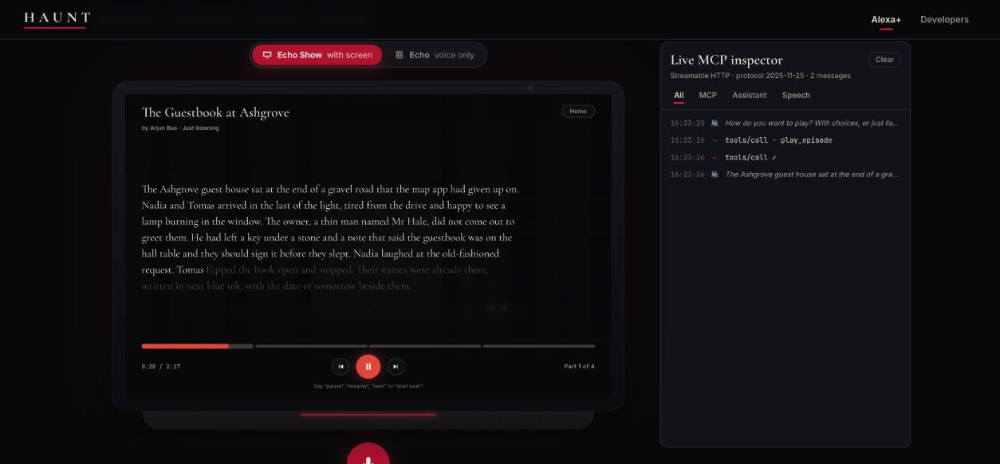

---

## Contents

- [Try it](#try-it)
- [Screenshots](#screenshots)
- [What you can do](#what-you-can-do)
- [Talking to it](#talking-to-it)
- [How it works](#how-it-works)
- [The MCP server](#the-mcp-server)
- [Run it locally](#run-it-locally)
- [Repository layout](#repository-layout)
- [Tests](#tests)
- [Deploying](#deploying)

---

## Try it

| Way | What you get | How |
| --- | --- | --- |
| **Live site** | The real backend: real email sign-in, real community stories, Bedrock and Polly | Open <https://haunt-alexa.vercel.app/alexa> |
| **Offline, 2 minutes** | Everything on your machine with a scripted story writer. No AWS account needed | `npm install`, then `npm run dev:mock`, and open <http://localhost:5173/alexa> |
| **Local page, live backend** | Your local copy of the page talking to the deployed backend | `npm run dev:live`, and open <http://localhost:5173/alexa> |
| **Your own AWS** | Local server with your Bedrock and Polly | Set up `.env`, then `npm run dev` ([details](#run-it-locally)) |

On the page, press the **mic** (that's "Alexa, …") and speak, or tap. Use the switch at the top to choose between an
**Echo Show** (with a screen) and an **Echo** (voice only).

> Community stories and creating need an account; My Stories works without one. Sign in from the Profile icon or say
> "sign in": scan the QR code with your phone, or get a code by email. In offline mode (`dev:mock`) no email is sent.
> The code appears in the terminal on a line starting `[auth:mock]`.

## Screenshots

### Echo Show (with a screen)

| | |
| --- | --- |
| 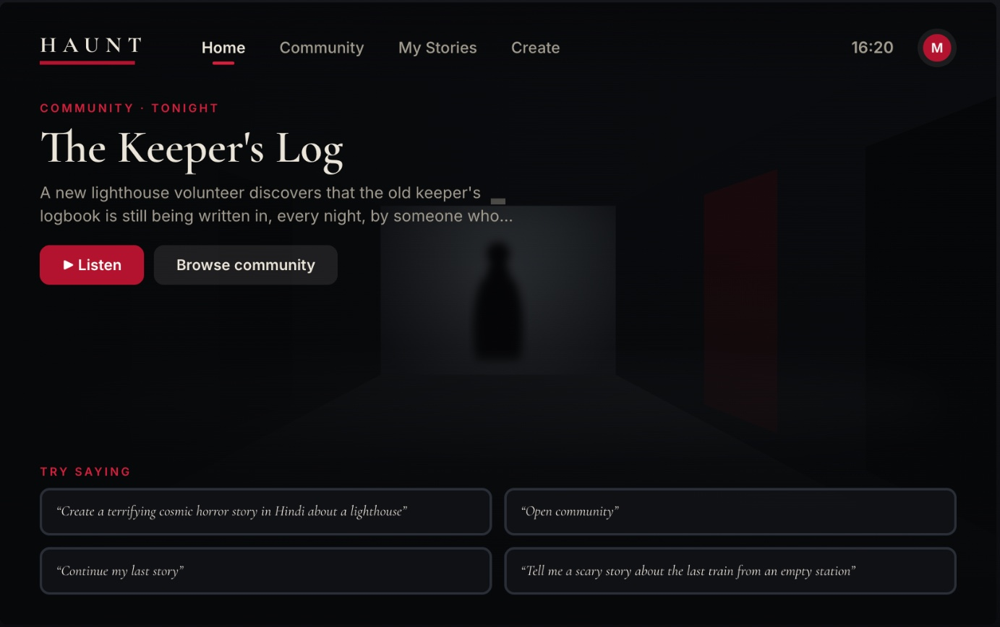 **Home.** Tonight's community story, and things to try saying. | 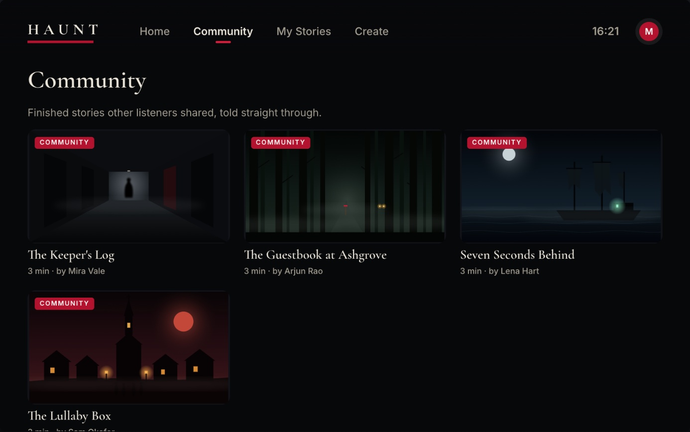 **Community.** Finished stories other listeners shared (`list_library`). |
| 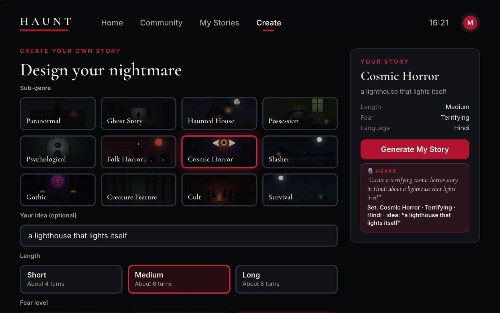 **Create.** Every `start_story` option, filled by touch or by one spoken sentence. | 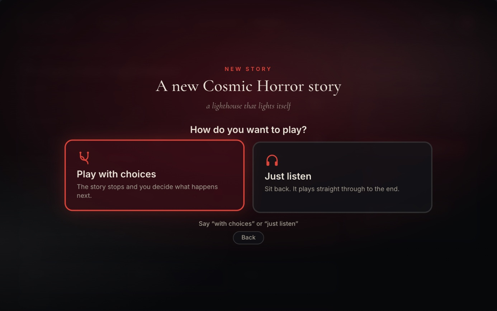 **Before every story:** play with choices, or just listen. |
| 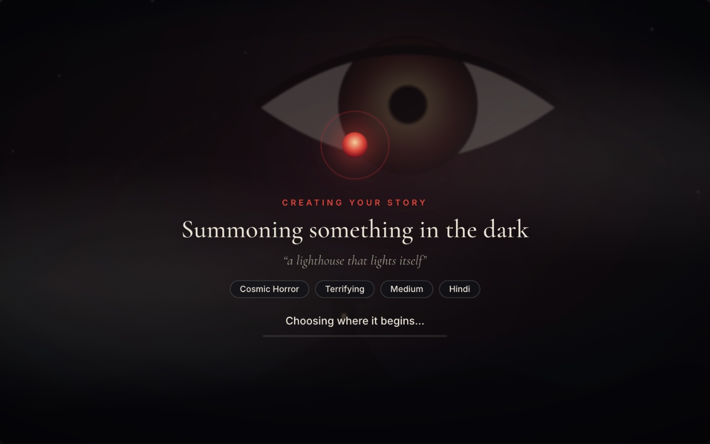 **While the story is being written** by Bedrock. | 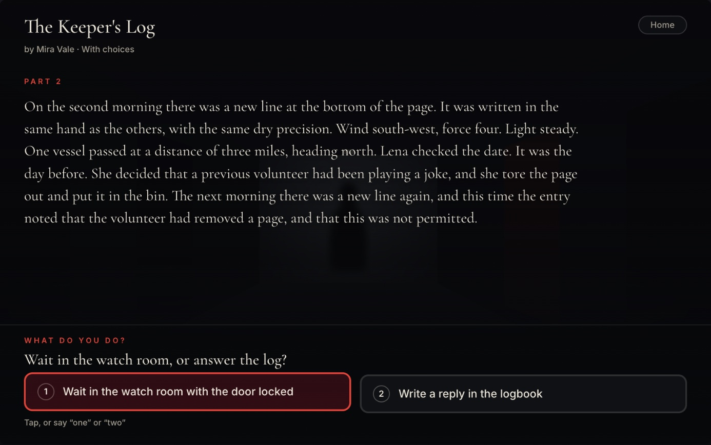 **With choices:** the story stops and you decide (tap, or say "one" / "two"). |
| 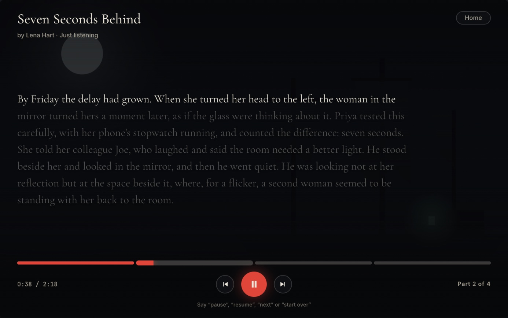 **Just listen:** plays like a film, with a timeline, pause and skip. | 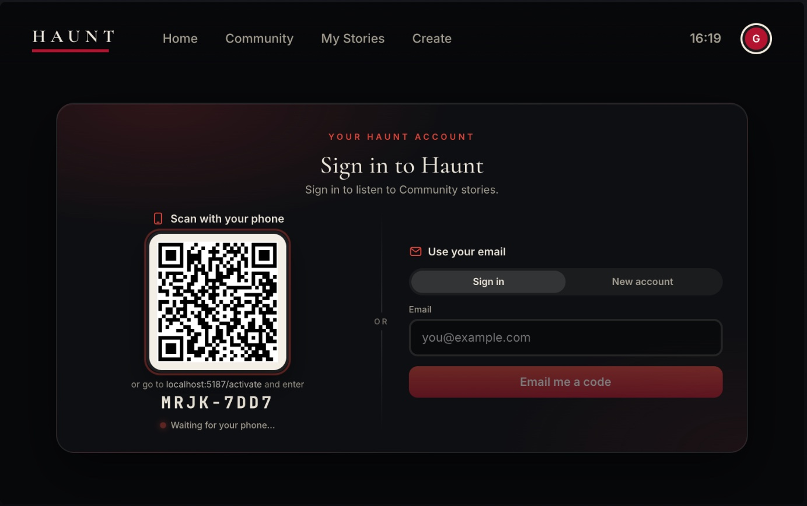 **Sign in** with your phone (QR) or your email, typed or spoken. |
| 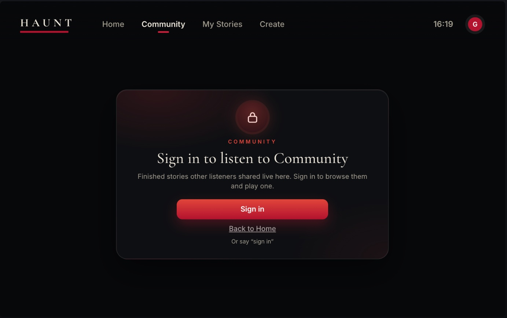 **Guests** are asked to sign in before Community and Create. | 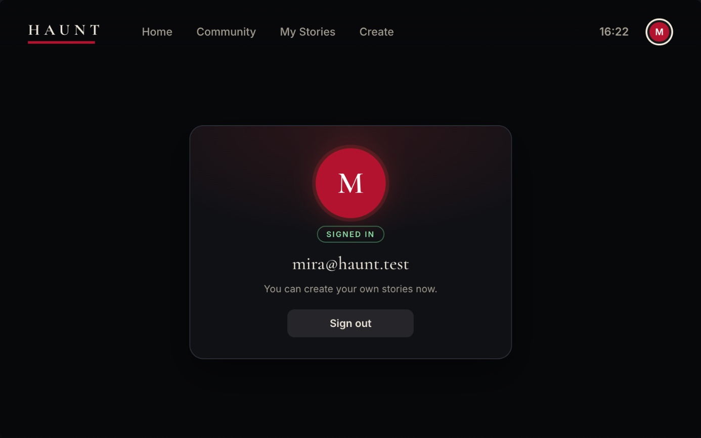 **Profile:** who's signed in, and sign out. |

### Echo (voice only)

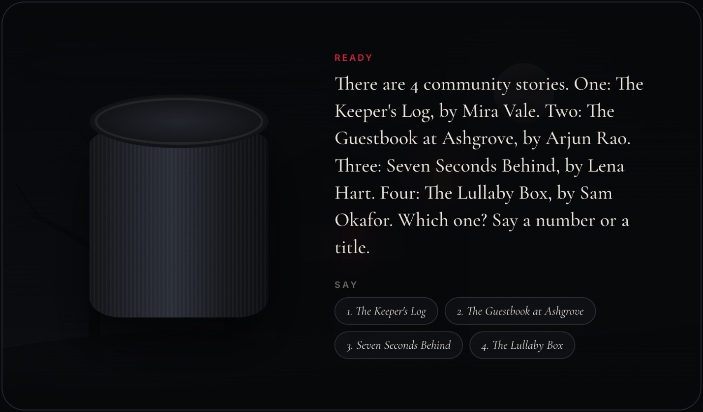

With no screen, the Echo runs everything through spoken menus. It greets you, reads lists aloud, takes a number or a
title, walks you through creating a story and signs you in by voice. The captions and hint chips are only there so
you can follow along in the simulator.

### Alexa skill (APL screens)

The Alexa skill in [`apps/alexa-skill`](apps/alexa-skill) brings the same experience to Echo Show devices with APL:

| | | |
| --- | --- | --- |
| 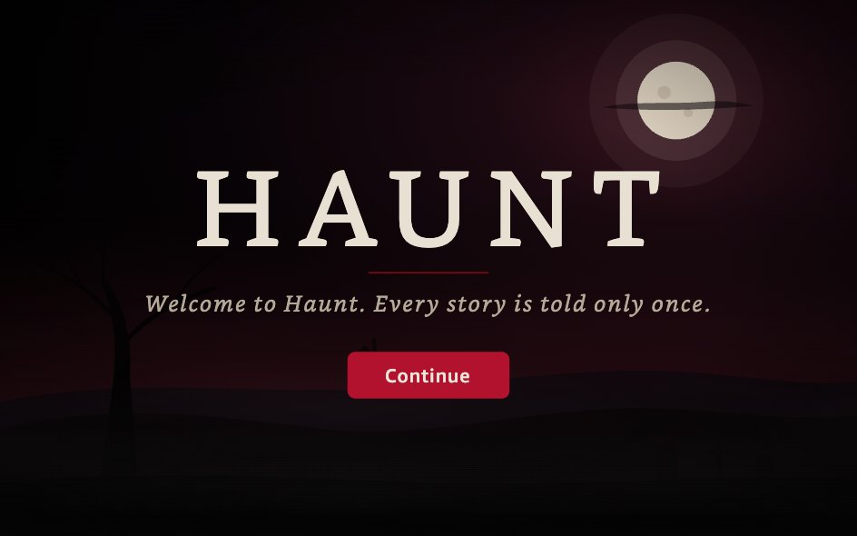 | 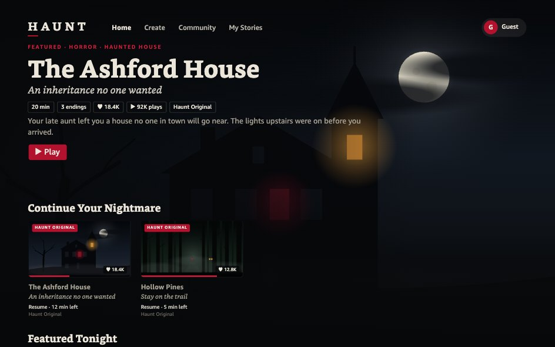 | 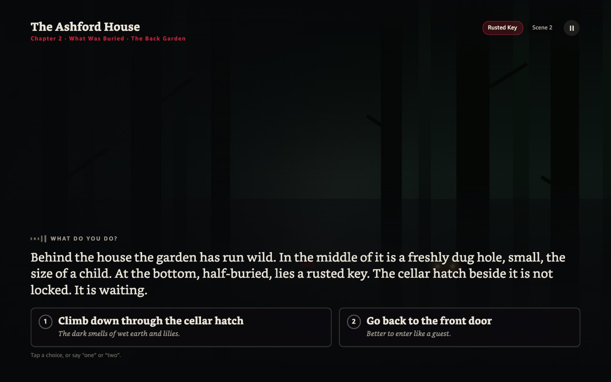 |

## What you can do

| On the Echo Show | Echo (voice only) | MCP tool |
| --- | --- | --- |
| **Home**: tonight's community story | "Community stories" | `list_library` |
| **Community**: browse and play finished stories | Reads the list; say "two" or a title | `list_library`, `play_episode` |
| **My Stories**: stories you started on this device | "My stories", "continue my last story" | `resume_story` |
| **Create**: sub-genre, your idea, length, fear level, language | "Create a story", then field by field or all at once | `start_story` |
| Answer the story's question | Say your answer, or "one" / "two" | `answer_story` |
| End a story | "End the story" | `end_story` |
| **Profile**: sign in with QR or email, sign out | "Sign in" (spoken email and code) | — |

Every story starts with **"How do you want to play?"**:

- **With choices:** the story stops at each question. Your answer, word for word, goes to `answer_story`, which writes
  what happens next. Community stories follow their branches.
- **Just listen:** the story plays straight through, with no questions, like a film. There's a chaptered timeline,
  pause/resume and previous/next part. For a story being written, the next part is written in the background while the
  current one plays.

## Talking to it

| Say | What happens |
| --- | --- |
| "Create a terrifying cosmic horror story in Hindi about a lighthouse" | Fills in Create from one sentence |
| "Haunted house" · "make it long" · "very scary" · "in Tamil" · "my idea is a door that won't stay shut" | Sets one field at a time |
| "Generate" | Starts the story (`start_story`) |
| "With choices" / "just listen" | Answers "How do you want to play?" |
| "Open community" · "my stories" · "go home" | Moves between tabs |
| "Play the first one" · "continue my last story" | Plays or continues a story |
| "One" · "two" · or your own words | Answers the story's question (`answer_story`) |
| "Pause" · "resume" · "next" · "previous" · "start over" | Controls the just-listen player |
| "End the story" | Ends it with a proper final scene (`end_story`) |
| "Sign in" · "sign out" · "help" · "menu" | Account and help, anywhere |
| "Tell me a scary story about the last train from an empty station" | Goes to the assistant (Claude on Bedrock with the Haunt skill), which calls the right tools |

## How it works

```
 Alexa+  /  the /alexa simulator  /  any MCP client
        │   speech → text            ▲ narration (Amazon Polly)
        ▼                            │
 ┌──────────────────────────── Haunt server (apps/server) ────────────────────────────┐
 │  MCP server  /mcp (bearer token)  ·  /api/mcp (Haunt's own pages)                   │
 │  start_story · answer_story · end_story · resume_story · list_library · play_episode │
 │  Story engine → Amazon Bedrock (Claude) writes each scene                           │
 │  Stories, library, progress → Amazon DynamoDB   ·   Sign-in → Amazon Cognito         │
 └─────────────────────────────────────────────────────────────────────────────────────┘
        │
        ▼  MCP Apps view (ui://haunt/scene-*): artwork, captions and choices on the display
```

- **Alexa+ (or any MCP client)** connects to `/mcp` and follows the **Agent Skill** in
  [`skills/haunt/SKILL.md`](skills/haunt/SKILL.md). The skill tells it to pass the listener's words to the tools verbatim
  and stay out of the story's way.
- **The `/alexa` simulator** is an MCP host in the browser. It calls the same tools through `/api/mcp`, renders the scene
  view on the Echo Show screen, narrates with Polly, and shows every MCP message in the **Live MCP inspector**.
- **Story answers go straight to the story tools.** Open-ended requests ("tell me a story about…") go to the assistant
  (`/api/agent`, Claude on Bedrock with the Haunt skill and the MCP tools).
- **The deployed version** runs the server on AWS Lambda behind API Gateway. The web app is on Vercel, which forwards
  `/api` and `/activate` to it (see [`vercel.json`](vercel.json)).

## The MCP server

| Endpoint | For | Auth |
| --- | --- | --- |
| `POST /mcp` | Alexa+, MCP Inspector, other clients | Bearer token from `HAUNT_MCP_TOKENS` (open on localhost in development when unset) |
| `POST /api/mcp` | Haunt's own pages (the `/alexa` simulator) | Same-origin, with the listener's sign-in |

| Tool | What it does |
| --- | --- |
| `start_story` | Starts a story from a premise, plus optional sub-genre, length, fear level and language, and returns the opening scene |
| `answer_story` | Takes the listener's words and writes what happens next |
| `end_story` | Ends the story with a proper final scene |
| `resume_story` | Returns the scene a story stopped at |
| `list_library` | Finished stories shared by the community |
| `play_episode` | A finished story's full narration, with its branches |

Each scene also comes as an **MCP Apps** view (`ui://haunt/scene-*`): artwork, captions and the narrator's question.

**Try it with MCP Inspector:** run `npm run dev`, then connect the Inspector to `http://localhost:3001/mcp`
(Streamable HTTP).

## Run it locally

You need **Node.js 22 or newer**.

```bash
git clone https://github.com/tejaswip08/haunt-alexa.git
cd haunt-alexa
npm install
```

| Command | What runs | Use it when |
| --- | --- | --- |
| `npm run dev:mock` | Server + web app. Story writer and assistant are scripted, the browser's voice narrates, and sign-in is offline (codes print in the terminal) | You want to try it with no AWS account |
| `npm run dev` | Server + web app with real **Bedrock** and **Polly**, using your AWS credentials | You have AWS access (see below) |
| `npm run dev:live` | Only the web app, talking to the **deployed backend**: real email sign-in and real community stories | You want the live data on your machine |

Then open **<http://localhost:5173/alexa>**. With `npm run dev` and `dev:mock`, the server is on port 3001
(MCP at `http://localhost:3001/mcp`).

### Using your own AWS (`npm run dev`)

```bash
cp .env.example .env
```

Then in `.env`:

```bash
AWS_PROFILE=your-profile        # or any standard AWS credentials
AWS_REGION=us-east-1
HAUNT_PROVIDER=bedrock
HAUNT_AGENT=bedrock
HAUNT_TTS=polly
HAUNT_AUTH=mock                 # offline sign-in codes; use Cognito ids for real email codes
NODE_ENV=development
```

Credentials come from the standard AWS chain, for example `aws sso login --profile your-profile`. Your account needs
access to the Bedrock model set in `.env` and to Amazon Polly. No keys are stored in this repo.

## Repository layout

| Path | What |
| --- | --- |
| [`apps/server`](apps/server) | MCP server, story engine, sign-in and the API |
| [`apps/web`](apps/web) | The website and the `/alexa` Echo Show / Echo simulator |
| [`apps/views`](apps/views) | MCP Apps scene views |
| [`apps/alexa-skill`](apps/alexa-skill) | Alexa skill (Lambda + APL screens) |
| [`skills/haunt`](skills/haunt) | Agent Skill for Alexa+ and other assistants |
| [`packages/firetales`](packages/firetales) | Story model and sub-genres |
| [`packages/scene-fx`](packages/scene-fx) | Scene sound and visual effects |
| [`deploy`](deploy) | AWS deployment templates and notes |
| [`docs/friction-log.md`](docs/friction-log.md) | What was hard while building on Alexa+, Bedrock and AWS |

## Tests

```bash
npm run typecheck
npm test
```

## Deploying

- **Web app (Vercel):** import this repo. [`vercel.json`](vercel.json) builds the views and the web app and forwards
  `/api` and `/activate` to the backend. Every push to `main` redeploys.
- **Backend (AWS):** `npm run build:lambda` builds the Lambda bundle. See [`deploy/DEPLOY.md`](deploy/DEPLOY.md) for the
  Lambda, API Gateway, DynamoDB and Cognito setup. The backend only answers Haunt's own sites, so add a new site's
  address to `HAUNT_STT_ORIGINS`.

## License

See [LICENSE](LICENSE). Haunt is an independent project built for the Amazon Developer Hackathon and is not affiliated
with or endorsed by Amazon. Stories are AI-generated fiction.
